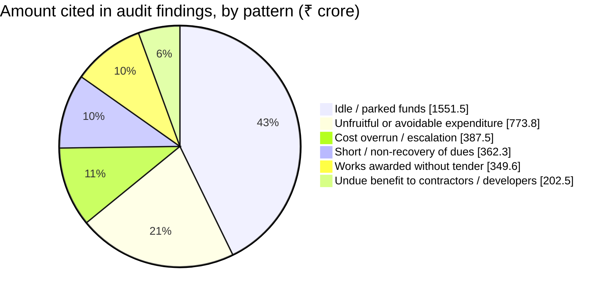

<div align="center">

# ScaleBridge

### AI that reads what India's auditors have already written, and turns it into faster approvals, cleaner procurement and fewer repeat failures.

**Mumbai pilot · Published CAG audit reports · Every answer cited to the page**

</div>

---

## What 15 published audit reports already tell us

| **126** | **₹3,627 crore** | **6** | **5,592** | **100%** |
|:---:|:---:|:---:|:---:|:---:|
| transaction-level audit findings extracted | cited in those findings | leakage patterns mapped | page-anchored passages searchable | of test questions answered with the right report and page |

Read the full study → **[`docs/IMPACT.md`](docs/IMPACT.md)**



| Pattern | Findings | ₹ crore cited | Reports |
|---|---:|---:|---:|
| Idle / parked funds, pending utilisation certificates | 17 | 1,551.5 | 8 |
| Unfruitful or avoidable expenditure | 26 | 773.8 | 8 |
| Cost overrun / escalation | 14 | 387.5 | 4 |
| Short / non-recovery of dues | 29 | 362.3 | 9 |
| Works awarded without tender / on nomination | 10 | 349.6 | 5 |
| Undue benefit to contractors / developers | 30 | 202.5 | 8 |

### Four findings, straight from the reports

> **₹140.04 crore**: supply orders for 66 escalators on the Mumbai Monorail were placed *"without competitive bidding."*
> <sub>CAG, Maharashtra Report 4 of 2015, Ch. 3, p.13</sub>

> **₹185.97 crore**: compensation for delay *not recovered* by CIDCO across 22 contracts worth ₹4,759.94 crore, though the delays were attributable to contractors.
> <sub>CAG, PSU Report 5 of 2019 (CIDCO infrastructure), p.21</sub>

> **₹99.30 crore**: 29 additional works outside the original scope *"assigned to the existing contractors without inviting tenders."*
> <sub>CAG, Annual Technical Inspection Report on Local Bodies 2017, Ch. 3, p.12</sub>

> **₹18.49 crore**: slum FSI sanctioned on a school plot, an *"undue benefit to the developer"* (Slum Rehabilitation Authority, Mumbai).
> <sub>CAG, Compliance Audit for the year ended March 2024, p.292</sub>

<sub>Amounts are as cited by audit, not a measured loss. Transaction-level findings only (under ₹1,000 crore each); state-wide balances are listed separately in the study. A manual check of the ten largest rows found 8 of 10 amounts correctly attributed; see <a href="docs/IMPACT.md">method and limits</a>.</sub>

---

## Why this matters

The Brihanmumbai Municipal Corporation budgets over **₹80,000 crore** a year (FY27). Yet a 2023 special audit found **₹214 crore** of works awarded without tender and **₹4,756 crore** of works executed without contracts. Maharashtra's Urban Development Department had **₹11,040 crore** of utilisation certificates pending in 2024-25.

The audit trail exists. What's missing is intelligence on top of it: today, every report is read once, filed, and forgotten until the same failure happens again.

| Task | Today | With ScaleBridge |
|---|---|---|
| Find every past audit finding on a body, scheme or contractor | Days to weeks of manual reading | Seconds, with page citations |
| Spot patterns across years and bodies | Rarely done | One table across the whole archive |
| Prepare for an audit or reply to an observation | Institutional memory | Prior findings and replies, sourced |
| Stop a known failure in a new tender | Depends on who's in the room | Tender checked against documented failure patterns |

---

## The platform

| | Module | What it does | Status |
|---|---|---|---|
| **M4** | **Audit intelligence** | Cited Q&A and leakage-pattern mining across published CAG reports | ✅ **v0.1 working** |
| M2 | Procurement integrity | Reads tenders, bids and work orders; flags no-tender awards, missing contracts, split works, escalation; drafts the committee note | 🧩 Designed ([principles](docs/design_principles.md)) |
| M1 | Approvals & NOCs | Tracks every NOC against statutory timelines; checks developer obligations after approval | 📐 Specified |
| M3 | Audit readiness | Helps agencies assemble evidence and reply to audit observations so paras get settled | 📐 Specified |

Full design: [`SKELETON.md`](SKELETON.md) · Go-to-market: [`gtm/`](gtm/) · Evaluation: [`eval/results.md`](eval/results.md)

---

## Try it

```bash
python scripts/build_manifest.py          # download published CAG reports (public PDFs)
python -m scalebridge.cli ingest          # PDFs -> page-anchored passages + local index
python -m scalebridge.cli ask "Which works were awarded without inviting tenders?"
python -m scalebridge.cli patterns        # leakage patterns across all reports
python scripts/impact_report.py           # regenerate docs/IMPACT.md
python eval/run_eval.py                   # retrieval evaluation
```

Optional: `pip install -r requirements.txt` and add `--llm` to `ask` for a Claude-written answer in which every sentence must cite a passage.

---

## Built to be trusted

- **Evidence or nothing:** every output cites report and page; when the evidence isn't there, it says **NOT FOUND**.
- **People decide:** AI prepares, checks, flags and drafts. Permits, payments, awards and audit replies stay with officials.
- **Sovereign by design:** search and tagging run fully offline, on an agency's own servers.
- **Public data only:** published CAG reports and synthetic data; no inspection reports, draft paragraphs or auditee records.
- **Evaluation first:** gold and held-out question sets, with honest limits documented.

**Pilot:** Mumbai: BMC and related departments, alongside the Urban Development Department's July 2026 study group on AI-based audit of civic works. Twelve weeks, shadow mode first.

**Beyond India:** the same modules apply to municipal permitting and supreme audit institutions in the Gulf, with Arabic evaluation sets.
